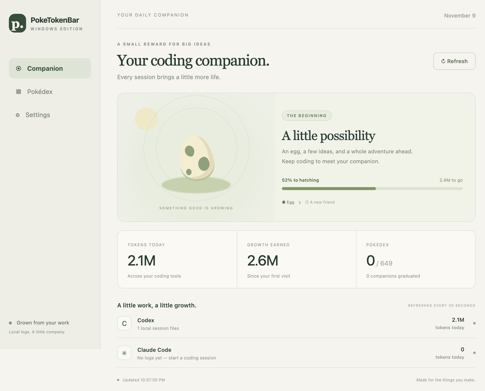
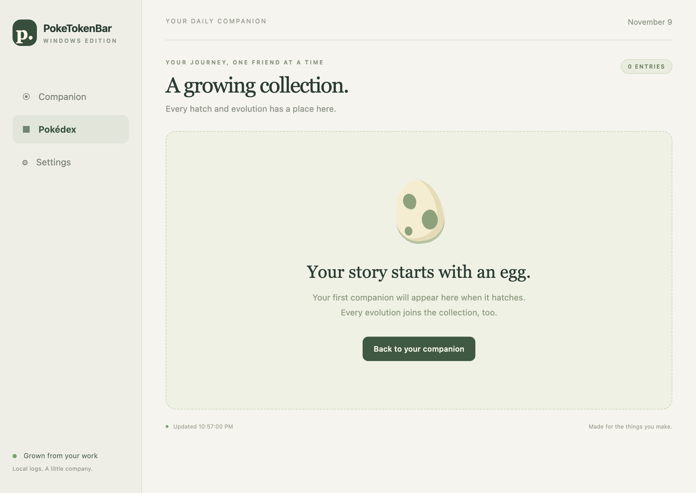
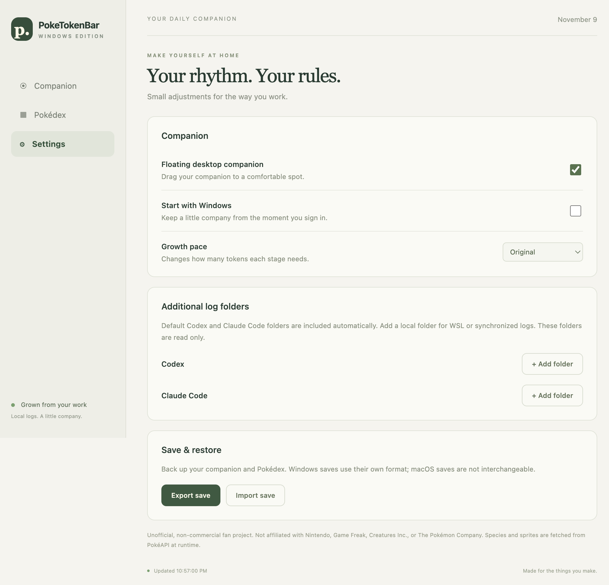

# PokeTokenBar for Windows

A Windows companion for your everyday coding. Local Codex and Claude Code usage
hatches an egg, grows a Pokémon through its evolution line, and fills your Pokédex.
This is an independent Electron/TypeScript client in the `tykim0507` fork. The
original SwiftUI macOS application is unchanged.

## Install

Windows 10/11, x64. Download **PokeTokenBar-Windows-x64** from a successful
[Windows desktop workflow run](https://github.com/tykim0507/PokeTokenBar/actions/workflows/windows.yml).
Extract the artifact and choose:

- `*-nsis.exe`: per-user installer, with an optional install directory.
- `*-portable.exe`: run without installation. Saves still live in your Windows
  user profile, not beside the executable.

Builds are unsigned; Windows may show an unknown-publisher prompt. There is no
self-updater in this initial version. Install a newer build to update; saves are
preserved. Closing the window hides it in the notification area. Right-click the
tray icon to open, refresh, or quit.

## Included

- Codex and Claude Code local token usage, refreshed every 30 seconds.
- Windows tray icon and draggable, always-on-top desktop companion.
- Egg hatching, capture-rate-weighted Gen 1–5 selection, real evolution chains
  (one randomly chosen branch), shiny rolls, graduation, and a persistent Pokédex.
- Growth pace, additional scan folders, and optional startup at Windows sign-in.
- Atomic local saves, a previous-save backup, and Windows save import/export.
- Animated sprites and species data fetched at runtime and cached locally.

The native app's shops, Rare Candy, official account limit percentages, other
usage providers, account integrations, and macOS save import are **not** ported.
Windows and macOS use separate save formats. This client does not connect to SSH
servers: add an already-synchronized local folder in Settings to count remote logs.

## Usage and growth

Default roots are `%USERPROFILE%\.codex\sessions`,
`%USERPROFILE%\.codex\archived_sessions`, and
`%USERPROFILE%\.claude\projects`. `CODEX_HOME` and `CLAUDE_CONFIG_DIR` override
the corresponding tool home. For WSL, add its accessible `\\wsl.localhost\...`
session/project directory in Settings. An unavailable explicit folder shows an
error and pauses growth credit for that provider until the scan succeeds.

The first successful scan sets a baseline: historical tokens are displayed but
not awarded as new growth. Subsequent increases in **today's** provider totals
count toward growth. Previous days discovered later are not backfilled. Days use
the computer's local timezone. Keep the app running and remote logs synchronized
before local midnight to count that day's work. Deleting and restoring logs does
not award the same day's tokens again. High-water marks persist for 35 days.

Codex input already includes cached input; output already includes reasoning.
These are counted once. Claude input, output, cache-write, and cache-read are
separate buckets. Session/state deduplication handles overlapping folders and
archival copies. Manual Codex forks use parent usage-prefix matching, with the
native reader's timing fallback when their parent is unavailable. Subagent usage
is preserved. Malformed lines are skipped, incomplete final writes are retried,
and JSONL lines over 2 MiB are skipped to bound memory.

At original pace, an egg needs 5 million tokens. Growth thresholds use the native
app's rarity balance. Tokens beyond a stage threshold carry forward. When PokéAPI
is unreachable, earned tokens remain saved and hatching retries on refresh.
An uncached sprite may temporarily show a placeholder. Existing cached sprites
continue to work offline.

## Development

Install Node.js 24 LTS and npm, then from this directory:

```sh
npm ci
npm test
npm run test:e2e
npm start
```

The Electron shell can also run on macOS for development, in a separate user-data
directory from the native app. On Windows:

```sh
npm run package:win
node scripts/smoke-packaged.mjs
```

Installers appear in `release/`. The Windows workflow runs core tests, real desktop
interaction tests, builds both executable formats, and launches the packaged app.
The e2e test uses isolated synthetic logs and saves; it does not read developer
usage. Test screenshots are in `test-results/`. No external API is needed by tests.

Use `npm run format` and `npm run format:check` for formatting. The build pins
Electron and the packager in `package-lock.json`; a scoped override updates
vulnerable minimatch 7–10 dependencies to its patched modern API. Legacy minimatch
consumers remain on their compatible versions. Installer CI exercises this override.

## Structure

- `src/core/usage.ts`: pure provider parsers and Codex replay/deduplication.
- `src/core/scanner.ts`: bounded streaming reads and per-file metadata cache.
- `src/core/growth.ts`: provider-independent token ledger and growth reducer.
- `src/core/storage.ts`: validated, atomic saves and backup recovery.
- `src/core/pokemon.ts`: constrained PokéAPI requests and runtime caches.
- `src/core/controller.ts`: scan → credit → save → evolve orchestration.
- `src/main.ts`: tray, windows, native dialogs, and validated IPC.
- `src/preload.ts`: narrow bridge; the renderer has no Node.js or filesystem access.
- `src/renderer.ts` / `styles.css`: local UI shared by the main and floating windows.

Saves and cached assets are under `%APPDATA%\poketokenbar-windows\`.
`companion.json` is the collection and growth state, `companion.json.bak` its prior
valid save, and `settings.json` the local preferences. Export excludes scan paths
and credentials. An invalid primary save falls back to its validated backup; if
both are invalid, startup reports an error instead of silently resetting progress.

## Privacy and assets

The app only reads log files; it never executes a coding agent or uploads prompts,
usage, or filesystem paths. Parsed metadata stays in memory. Only Pokémon cache
requests go to `pokeapi.co` and `raw.githubusercontent.com/PokeAPI/sprites`.
The renderer cannot navigate or access the network; the main process fetches and
caches allowlisted assets. No Pokémon images, fonts, bulk species data, credentials,
private hostnames, or machine configuration are bundled.

This remains an unofficial, non-commercial fan project, not affiliated with
Nintendo, Game Freak, Creatures Inc., or The Pokémon Company. The repository's
[MIT license](../LICENSE) covers code, not third-party trademarks or artwork.

## Preview

Sample-data screenshots of the production Electron UI running on macOS during
development (not Windows-native titlebar captures). No previous Windows screen
exists. The egg artwork is original CSS; no Pokémon artwork is bundled.



<details><summary>Pokédex and settings</summary>




</details>
